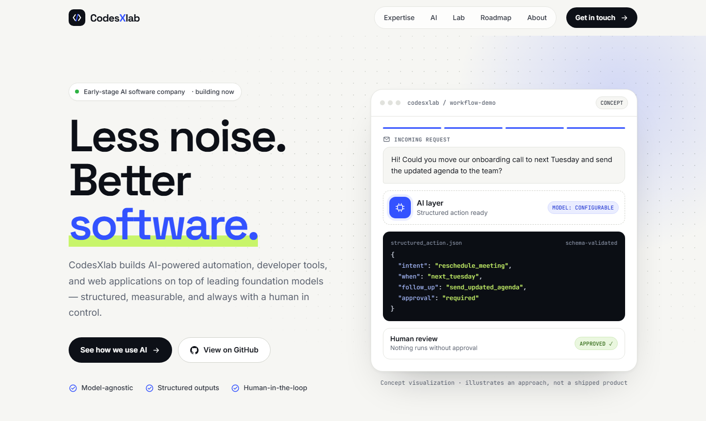

# Astro Launchpad

A one-page Astro theme for early-stage AI and developer-tool startups. Motion bento layout, an animated product demo in the hero, honest "Now / Next / Later" roadmap, and zero client-side framework: every word on the page lives in one typed config file.



**Live demo:** [www.codesxlab.com](https://www.codesxlab.com), the site this theme was extracted from.

## Features

- **One config file.** All copy, links, and demo content live in [`src/site.config.ts`](src/site.config.ts), typed by [`src/types/config.ts`](src/types/config.ts). Rebranding means editing data, not components.
- **No framework runtime.** Plain Astro components. The only JavaScript is three small inline scripts: the mobile menu, scroll reveal, and the hero demo.
- **Fast by default.** Self-hosted fonts with preload, inlined CSS, no external requests. Lighthouse 100 for performance, accessibility, best practices, and SEO on mobile and desktop (Lighthouse 12, measured on a local production build).
- **No layout shift from web fonts.** Metric-matched fallback faces (`size-adjust`, `ascent-override`, …) keep text in place while the fonts load, so the font swap does not move the page.
- **Accessible.** Skip link, labelled landmarks, keyboard-friendly menu (Escape closes it), visible focus styles, and `aria-current` on the active nav link.
- **Respects reduced motion.** With `prefers-reduced-motion`, every animation stops and each visual shows its final state.
- **Works without JavaScript.** Content never waits on a script; the hero demo renders its finished state as HTML.
- **SEO basics included.** Canonical URL, Open Graph and Twitter cards with absolute image URLs, `robots.txt`, `sitemap.xml`, and a real 404 page (`noindex`).
- **Responsive.** Tested at 1440, 820, 390, and 320 px with no horizontal overflow.

## Quick start

```sh
npm create astro@latest -- --template codesxlab/astro-launchpad
```

Or clone the repository:

```sh
git clone https://github.com/codesxlab/astro-launchpad.git my-site
cd my-site
npm install
npm run dev
```

Requires Node.js 22.23 or newer (Astro 7).

## Make it yours

1. **Copy and links:** edit [`src/site.config.ts`](src/site.config.ts). Start with `url`, `name`, and `meta`; your editor will autocomplete every field.
2. **Colors, radius, fonts:** edit the tokens in [`src/styles/tokens.css`](src/styles/tokens.css).
3. **Sections:** reorder or remove them in [`src/pages/index.astro`](src/pages/index.astro). If you remove one, also remove its link from `nav.links`.
4. **Social image and favicon:** replace `public/og-cover.png` (1200×630) and `public/favicon.svg`. `public/og-cover.svg` is the editable source of the cover.
5. **Logo:** the code-bracket glyph lives in [`src/components/ui/Logo.astro`](src/components/ui/Logo.astro). Set `nameHighlight` in the config to color one letter of your name.

A few fields accept simple links in Markdown style, e.g. `[intentflow](https://github.com/codesxlab/intentflow)`. They are marked `InlineText` in the types.

## Project structure

```text
public/
  fonts/                 Inter, Space Grotesk, JetBrains Mono (SIL OFL)
  favicon.svg
  og-cover.png
src/
  site.config.ts         All copy and links
  types/config.ts        Types for the config
  styles/
    tokens.css           Design tokens and @font-face
    global.css           Base styles, layout utilities, reveal animation
  components/
    ui/                  Button, Card, Chip, Icon, Logo, SectionHead, TerminalLines
    sections/            Header, Hero, WorkflowDemo, FocusStrip, Expertise, AiBento,
                         Lab, OssSpotlight, ConceptCard, Approach, Roadmap, About,
                         Contact, Footer
  layouts/BaseLayout.astro  <head> metadata and the scroll-reveal script
  pages/
    index.astro          The one-page site
    404.astro            Not-found page with links back to every section
    robots.txt.ts
    sitemap.xml.ts
```

Each component keeps its styles in a scoped `<style>` block. Scoping uses `:where()` (`scopedStyleStrategy: 'where'`), so selectors keep the specificity you write.

## Commands

| Command           | Action                                         |
| :---------------- | :--------------------------------------------- |
| `npm run dev`     | Start the dev server at `localhost:4321`       |
| `npm run check`   | Type-check `.astro` and `.ts` files            |
| `npm run build`   | Type-check, then build the site into `./dist/` |
| `npm run preview` | Preview the production build locally           |

## Deploy

`npm run build` produces a static site in `dist/`. Upload it to any static host.

- **Netlify, Vercel, Cloudflare Pages:** they serve `404.html` with a 404 status automatically.
- **Apache:** add `ErrorDocument 404 /404.html` to `.htaccess`.
- **nginx:** add `error_page 404 /404.html;`.

## Writing honest copy

The theme was built for a company at its very beginning, and its default copy reflects that: concepts are labelled as concepts, the roadmap separates what exists from what is planned, and there are no invented logos, metrics, or testimonials. If you adapt it, keep it that way. The `CONCEPT` and `CONCEPT STUDY` badges are there for a reason.

## License

The code is released under the [MIT License](LICENSE). The bundled fonts are licensed under the SIL Open Font License 1.1; see `public/fonts/OFL-*.txt`.

Built by [CodesXlab](https://www.codesxlab.com).
